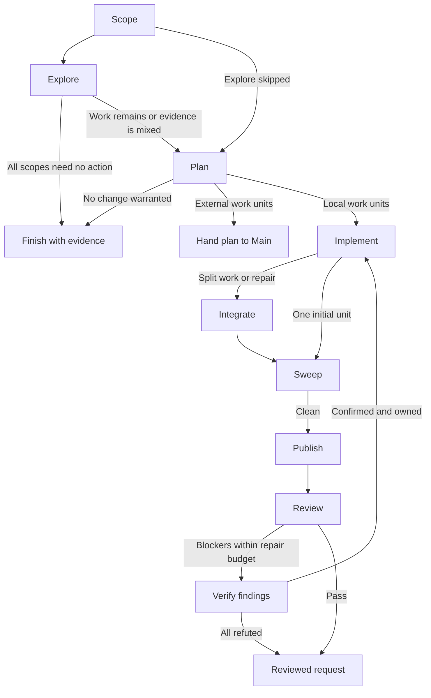

# Workflow samples

Workgraph bundles one adaptive native Workflow delivery sample.
The [model and effort settings](#models-and-effort) apply per phase.
It uses the native Workflow interface without adding a scheduler, execution engine, or repository dependency.
This optional complete-delivery recipe declares its own phases and review coverage.
Explore or Plan can finish the run when the evidence shows the goal needs no changes.
When changes are needed, the sample publishes and reviews a PR or MR.
Merging that request follows [Delivery's separate merge authority](../skills/delivery/SKILL.md#establish-merge-authority).
Choose a smaller graph or direct execution when the requested outcome does not need this process.
Its scope count and repair limit are sample-specific choices, not global Workgraph requirements.

| Workflow | Source | Shape |
| --- | --- | --- |
| Delivery | [delivery.js](../workflows/delivery.js) | Up to four scopes and four disjoint units, with integration conditional on the plan defining several units. |

## Launch

Run a sample from a checkout the session can read, passing the goal and dispatch choices through `args`.
Pass the registered workflow name on the first invocation.
Use the `scriptPath` and run ID the run returns, with `resumeFromRunId`, for a same-session continuation.
The plugin exposes each workflow by its metadata name.

```js
Workflow({
  name: 'workgraph:adaptive-delivery',
  args: {
    task: 'Fix the parser bug and verify the original trigger.',
    repository: 'github.com/example/project',
    baseBranch: 'main',
    candidateBranch: 'task/fix-parser',
    issue: '#12'
  }
})
```

```js
Workflow({
  args: {
    task: 'Fix the parser bug and verify the original trigger.',
    repository: 'github.com/example/project',
    baseBranch: 'main',
    candidateBranch: 'task/fix-parser',
    issue: '#12'
  },
  resumeFromRunId: '<run ID returned by the first run>',
  scriptPath: '<scriptPath returned by the first run>'
})
```

The plugin discovers the bundled `.js` definitions in `workflows/`.
The dispatching session owns the task branch, initial candidate inspection, and any required issue.

## Read-only design

For read-only design work, use the [Workflow skill](../skills/workflow/SKILL.md), which admits only the Claude Code Main Agent before loading its read-only design procedure.
That procedure describes requirement coverage, challenge, verification selected for the task, and the tool boundaries needed for delegation.

## Dispatch inputs

| Input | Contract |
| --- | --- |
| `task` | Required nonempty string holding the delivery goal. |
| `scope` | Optional scope from Main. Supplying it bypasses the Scope agent. |
| `issue` | Optional nonempty issue reference included in the publication and review prompts. |
| `repository` | Required before publication. Use the authorized repository's canonical host and project path, such as `github.com/example/project`. |
| `baseBranch` | Optional base branch string resolved during scope and used by downstream prompts, defaulting to the repository's default branch. |
| `candidateBranch` | Required before any implementation dispatch, naming the task branch the worker must verify as its starting reference and the exact integration destination for several units. |
| `skips` | Optional object of boolean phase flags that skip dispatch without waiving required acceptance. |
| `models` | Optional object of per-phase model selector strings. |
| `efforts` | Optional object of per-phase effort strings. |
| `promptParts` | Optional object of per-phase instruction strings injected into the composed prompts. |
| `maxFixRounds` | Optional integer from 0 through 3 bounding review-driven fix rounds, defaulting to 1. |

### Reuse a scope from Main

Pass the scopes, supporting evidence, and resolved base from Main's assessment.
The base may appear in `args.baseBranch` or `args.scope.baseBranch`; if both are present they must match.
Provide `scope.checkoutRoot` when parent-relative aliases need resolving.
For example, the following arguments start agent work at Explore.

```js
Workflow({
  name: 'workgraph:adaptive-delivery',
  args: {
    task: 'Fix the parser’s handling of escaped quotes.',
    repository: 'github.com/example/project',
    baseBranch: 'main',
    candidateBranch: 'task/fix-parser',
    skips: { scope: true },
    scope: {
      evidence: 'The failing escaped-quote case exercises src/parser.',
      scopes: [{ key: 'parser', description: 'Quoted token parsing', paths: ['src/parser'] }]
    }
  }
})
```

A valid `scope` is sufficient even when `skips.scope` is omitted.
The graph records Scope as completed with `source: "argument"` and runs the same ownership checks used for agent output.
A plan that needs paths outside the supplied scope requires Main to revise that scope before workers start.
Skipping Scope without supplying its result leaves its successors blocked.

## Phases



| Phase | Required predecessor data | Completion evidence |
| --- | --- | --- |
| Scope | The delivery goal and optional base branch. | The resolved base branch and disjoint scopes with keys, descriptions, and owned paths. |
| Explore | One scope per explorer. | Per-scope summary, risks, evidence, and an optional reason to stop. |
| Plan | The scopes and any exploration findings with evidence. | Work units with disjoint owned paths and instructions, or an evidence-backed reason to stop. |
| Implement | One unit per agent, with any matching exploration. | Owned-path changed files, verified starting ref and commit, checked unit commit, and checks that all passed. |
| Integrate | Authorized destination and expected starting commit, with all accepted unit branches and commits. | For several units or a repair, named unit branches merged, their resource states, and checks on the combined candidate commit. |
| Integrate | All accepted unit results after implementation completes. | For one initial unit, a conditional skip and the accepted unit branch. |
| Sweep | The checked candidate commit, base branch, and candidate checkout's untracked files. | Candidate and base commits inspected, coverage, and an exposure list that is empty when the change is clean. |
| Publish | Authorized repository, checked candidate and base commits, clean sweep, change summary, and any issue reference. | PR or MR URL with a created or updated action and readback of the posted repository, branches, and commits. |
| Review | The change summary and posted request with its accepted candidate and base commits. | Observed commits, coverage, verdict, concrete findings, and evidence. |
| Finding verification | The posted diff and the review's findings with their IDs. | Observed commits and an independently supported disposition for every finding. |

Implementation runs every unit in its own isolated native worktree, including a single-unit plan.
Each isolated worker verifies its worktree starts from the named task candidate before editing and synchronizes first when it does not.
Implementation requires `args.candidateBranch` to name the task candidate, which stays distinct from the publication base branch.
A missing candidate fails implementation before dispatch, so no editor edits from an unverified worktree start.
Scope resolves the base identity for a delivery run even when `args.baseBranch` is omitted, and implementation rejects a reported unit branch equal to that base.
When implementation is explicitly skipped and Main supplies no base, Scope can record `baseBranch: null` and pass its source evidence to Plan without requiring Git metadata.
The publisher verifies actual refs and branch protections before pushing, because reported names alone do not establish Git state.
A repair round carries the reviewed candidate branch and commit as its required starting point.
Express owned paths relative to the original checkout, including authorized parent or sibling paths such as `../shared`.
The same normalized paths govern exploration, ownership, changed files, and review findings.
Scope reports the original checkout root so local aliases such as `../project/src` and `src` resolve to the same owner when the checkout is named `project`.
The execution environment controls filesystem access.
If implementation needs external paths, the run returns `complete: false`, `earlyExit.kind: handoff`, the plan, and its intended owners.
Main can continue at each owning location and publish Git changes in the repository that contains them.
Checks report explicit passed, failed, or skipped statuses, and a gate passes only when every required check passed.
Each implementation worker is instructed to commit to a branch named for its unit, so the result records a reported branch even when its checks fail, while a failed or missing worker result can leave the branch identity unknown.
Claims by different units to the same branch block the implementation join even when their files are disjoint.
Unit results must agree on the starting commit used for the same implementation attempt.
Integration receives the named candidate and each planned unit path.
It checks the destination, resolved base, protections, unit commits, and actual branch diffs before writing.
Integration checks the expected destination start before changing the task ref and returns a moved destination to Main for reconciliation.
Each unit is judged by its own changes since its merge base with the destination, because the destination advances as other units integrate.
A direct comparison with the advanced destination would show another unit's integrated files as deletions and could reject a valid unit or repair.
A retained unit branch that the destination already contains has no new changes and reports as merged.
It merges only the named unit branches and reports changed paths and actual diff evidence.
The result must name the candidate, keep changed paths within ownership, account for every named branch, and pass combined checks.
These reports are evidence claims, not independent proof of Git state.
Resource states apply only when every claim names a current unit branch and agrees with the merge outcome and conflicts.
A rejected, contradictory, superseded-branch, malformed, or duplicate claim changes no known state.
A consistent partial failure keeps its reported states, and a completed merge with failed combined checks keeps its merged states.
For one accepted unit, integration records `skipped` with the reason that no cross-unit integration is required, and the accepted unit branch becomes the candidate for sweep, publication, and review.
Its resource stays `implemented`, not `merged`, because no merge occurred.
Publication always precedes review, and review requires the request posted by the completed publication phase.
Sweep, publication readback, and review must name the commits they covered.
A sweep with incomplete diff or untracked-file coverage blocks publication, and incomplete review coverage blocks acceptance.
A mismatch leaves the stage failed and its dependent stages unaccepted.
Publication and review receive the per-unit checks and the combined-candidate checks.
A fix round integrates the repaired unit branches into the original posted candidate, updates the same request, replaces only the repaired units' results by key, and reviews the candidate again.
The result retains the last posted URL if a later attempt fails, while phase status records the failure.
Accepted publication evidence remains in the graph.
A rejected publication readback also retains any observed request identity for recovery.
The scope, exploration, and sweep stages run with the built-in read-only Explore agent type, while review keeps the default agent and a read-only instruction.

## Executed graph

The result includes `graph.nodes` and `graph.edges` using the [Main contract's graph vocabulary](../skills/main-agent-contract/SKILL.md#coordinate-outcomes) and [dependency design](design.md#compose-work-through-the-host).
Each node records these fields:

| Purpose | Fields |
| --- | --- |
| Identity and operation | `key`, `operation` |
| Dependencies and data | `prerequisites`, `inputs`, `outputs` |
| Responsibility and authority | `owner`, `authority`, `ownership` where assigned |
| Outcome | `completionEvidence`, `status`, `reason` |

Result edges require accepted predecessor evidence, and condition edges record their predicate and whether the run required it.
Readiness derives from these edges rather than phase order alone.
Scope explorers and unit workers retain their own results alongside their coordinator joins.
Finding verification and repair attempts retain their own node records.
Every dispatch receives a graph-position block with the following:

- Prerequisite statuses
- Input contracts
- Downstream outputs
- Its owned unit or scope, when applicable

Stage prompts pass the predecessor fields the operation needs.
Planning joins every required scope result.
Workers receive one unit, matching exploration, and only the confirmed repair findings inside their paths.

## Skip, failure, and recovery

Each phase records `completed`, `skipped`, or `failed` with a reason.
Explore can end the run before Plan when every scope returns a nonempty `stopReason` and evidence, with no outstanding risks.
An empty risk list alone passes the scope to Plan.
Plan can stop when the issue is already resolved, invalid, or otherwise needs no change by returning `units: []`, a nonempty `stopReason`, and evidence.
An unexplained empty plan or a failed exploration leaves the run incomplete.
Both no-change exits return `complete: true`, `earlyExit` with the deciding phase, reason and evidence, and `publish: null`.
Later phases are recorded as skipped and dispatch no agents.
For a run that needs changes, completion requires the final review to pass and `earlyExit` is null.
Exploration may be explicitly skipped when the accepted task does not need it.
A skipped required phase does not pass, so skipping implementation or publication returns `complete: false`.
Integration is required for several units, so an explicit skip or failed integration blocks publication.
The one-unit conditional skip does not block delivery, while an explicit `skips.integrate` still blocks it.
The run result returns the separated scopes, each explorer's summary, risks, and evidence, and the sweep evidence so Main can check predecessor results.
The run result retains each branch identity reported by an implementation attempt and its recorded state, and superseded reported branches stay listed because the sample retires nothing.
A retained resource never counts as passing evidence.
A failed or missing predecessor skips its dependent phases, while successful sibling results remain available to Main.
Review checks each blocking finding against source, requirements, or a safe reproduction and includes that evidence in its report.
A `fix-required` verdict within `maxFixRounds` starts a separate read-only verifier under Review progress.
The verifier must account for every finding ID once and support its disposition with evidence from the same posted diff.
Missing, conflicting, or unverified dispositions block repair and leave the run incomplete.
An all-refuted result can finish without repair, with the original verdict and its verification both preserved.
Set `maxFixRounds: 0` when Main needs to assess the findings or revise the plan before authorizing repairs.
Main receives the verdict, evidence, and findings in `review` and each round's result and any verification in `reviewHistory`.
Each repair integrates into the posted candidate, then repeats the sweep, publication, and review.
A fix round replaces the repaired units' results by key, so unaffected unit evidence stays while combined-candidate evidence is regenerated.
A confirmed finding outside one unambiguous owned unit blocks the round for replanning.

## Models and effort

The delivery sample accepts optional selectors by phase through `args.models` and `args.efforts`.

| Phase | Default model request | Work |
| --- | --- | --- |
| Scope | Host selection | Resolve the base and define disjoint scopes. |
| Explore | `haiku` | Inspect assigned paths for evidence and remaining work. |
| Plan | `sonnet` | Decide whether to stop or assign work units. |
| Implement | Host selection | Change owned files and check the result. |
| Integrate | `sonnet` | Reconcile branches, ownership, conflicts, and combined checks. |
| Sweep | `haiku` | Inspect the diff and untracked files for exposures. |
| Publish | `haiku` | Check the destination and create or update the request. |
| Review | Host selection | Assess the posted candidate and blocking findings. |

An explicit selector in `args.models` takes precedence for that phase.
Finding verification uses the Review model and effort selectors in a separate call with its own output contract.
Omitted effort selectors use host configuration.
Main selects overrides using its [Claude Code guidance](../skills/main-agent-contract/references/claude-code.md#model-selection).
Claude Code applies its [workflow model policy](https://code.claude.com/docs/en/workflows) to the requested selector.
Every selector must be a nonempty string the host supports for agent calls.

Each dispatched graph node records `inputs.modelSelection.requestedModel` and its `source` (`argument`, `workflow-default`, or `host`).
A `host` record has a null requested model because the workflow omitted the selector.
Use host execution evidence to identify the model that actually ran.

## Cache reuse

Follow the [Workflow authoring reference](../skills/workflow/references/authoring.md) for continuation and cache reuse.
A changed candidate, destination, owned path, finding set, or verification contract invalidates affected evidence and dependent decisions.
Before resuming, check the live checkout, the named task and base branch refs, the toolchain configuration, and the posted request against what the recorded run used, because native cache keys carry none of that state.
A changed input invalidates the affected cached calls, so pass the changed state through the affected prompts or arguments and expect those calls to re-run.
Never reuse a sweep or a posted review for a changed accepted candidate, because the recorded evidence describes the earlier candidate.
The accepted commit enters the sweep, publication, review, and repair prompts, so a repair with a moved head does not reuse the earlier head's evidence.
Continuation can still replay a result from before an external ref or worktree moved.
Before resuming a writer, reconcile the recorded attempt with the actual Git and request state, including untracked files, partial merges, and any request already posted.
Refresh affected inputs and rerun the checks or sweep when that state no longer matches the recorded evidence.
